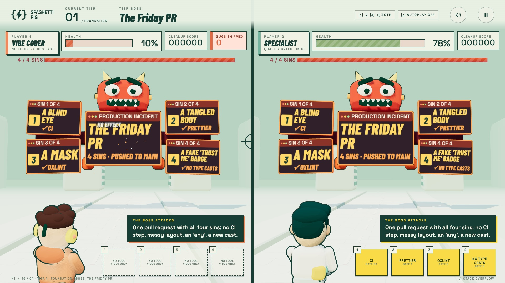
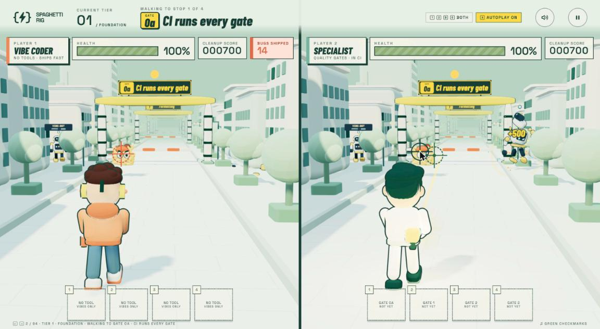

# Spaghetti Rig

**Walk the gates. Shoot to learn.** A 3D rail shooter for the stage that shows, in one sitting, why code quality gates matter.



Two developers walk the same road through six tiers. At every gate a piece of real bad code slams into both of them. Player 1, a vibe coder with no tools, keeps every hit and is finished off by the boss. Player 2, a code quality specialist, plays a tool card that fixes the code and heals to 100%, then breaks the boss with the tools earned on the way.

Every card is real: the bad code, the fix and the tool config come from Omer Gilad's quality-gate ladder (gates G00a to G15) as it was run on a real app, AppyRig. The game is a companion to Omer's [Spaghetti Busters](https://spaghetti-busters.vercel.app), made to look like it came from the same studio. It runs on one laptop, offline: fonts, art, music and physics all ship in the repo.

**Status:** finished and frozen for the Spaghetti rig run · all six tiers playable · True at `860ff4d` (2026-10-23)

## The story in three releases

The game was built by AI from one prompt, played by a human, then refactored from David's notes. Each step is a release:

| Release                                                                                         | What it is                                                                                                                                                                    |
| ----------------------------------------------------------------------------------------------- | ----------------------------------------------------------------------------------------------------------------------------------------------------------------------------- |
| [v1 – The build](https://github.com/appydave/spaghetti-rig/releases/tag/v1-build)               | One prompt, one build: the whole game, made playable over the network and fixed after a first Chrome play-through                                                             |
| [v2 – The refactor](https://github.com/appydave/spaghetti-rig/releases/tag/v2-refactor)         | Eight fixes from a human play-through: real clicks fire, a boss you can read, gate badges, human-like autoplay, a "you vs autopilot" mode, missed enemies become bugs shipped |
| [v2.1 – Architecture](https://github.com/appydave/spaghetti-rig/releases/tag/v2.1-architecture) | Tier 6 unlocked with cards from the last three gates; the frozen version the Spaghetti rig runs against                                                                       |

Next, the game's own code goes up the same ladder. The **Spaghetti** rig, built on AppyRig, will run the gates against this repo, one pull request per gate. That's why the game has no CI or linter yet: adding them is the first gates' job.

## Run it

Needs Node 20.19 or later (Vite 7).

```sh
npm install
npm run dev        # http://localhost:5173 (DEV_PORT=5174 npm run dev for another port; a taken port fails)
```

Click to play, pick a mode with `1`, `2`, `B` or `S`, and press `Enter` on the tier map. The dev server listens on the network, so another machine can open it by its Bonjour (`.local`) or Tailscale (`.ts.net`) name or by IP.

## Play it



| Mode             | Key | Who plays                                                                         |
| ---------------- | --- | --------------------------------------------------------------------------------- |
| Player 1         | `1` | The vibe coder alone, full screen                                                 |
| Player 2         | `2` | The specialist alone, full screen                                                 |
| Both             | `B` | Side by side                                                                      |
| You vs autopilot | `S` | Side by side: you play the specialist with the mouse, the vibe coder plays itself |

The whole show runs from the keyboard, so a presentation clicker works:

| Key                         | Does                                                                                                       |
| --------------------------- | ---------------------------------------------------------------------------------------------------------- |
| `→` / `Space` / `Page Down` | Next: walk on, play the card, skip a pause. Keys never shoot.                                              |
| `←` / `Page Up`             | Back one step                                                                                              |
| `Shift+1` … `Shift+6`       | Jump to a tier                                                                                             |
| `A`                         | Autoplay on / off (or click its button in the top bar). It aims, misses and fires in bursts like a person. |
| `M` / `P`                   | Mute / pause                                                                                               |
| `N`                         | Speaker notes strip                                                                                        |
| `H`                         | How to play                                                                                                |
| `Esc`                       | Close / back to the map                                                                                    |
| Mouse / trackpad            | Aim, then click or tap to shoot                                                                            |

Switching mode keeps your place. An enemy that gets past player 1 adds to **bugs shipped**; one that gets past player 2 is **caught by CI**. Missing never costs health.

**Presenter view:** open `http://localhost:5173/?presenter` in a second window. It follows the game, shows the card's `say` line, presenter notes and the tool's config, and its keys and buttons drive the game too.

## Content

All words and code come from [`public/content/cards.json`](public/content/cards.json). It's version 13 of the cards written during the AppyRig run, each one drawn from a real pull request (the run's own repo is private). Add a stop or a tier and reload: it appears with no code change. A tier with no stops is locked on the map and shows its boss. Tool card pictures are `public/assets/tools/<tool key>.svg`; a tool without one uses `generic.svg`. Art credits are in [`public/assets/ASSETS.md`](public/assets/ASSETS.md).

## Tests

```sh
npm test           # Vitest: content, the show script, health maths, gate labels, boss layout, autoplay
npm run test:e2e   # Playwright: full playthrough, real mouse and keyboard input in every mode
```

## How it was made

The prompts, rulings, spec and build record are in [`docs/origin/`](docs/origin/):

- [`1-human-prompts.md`](docs/origin/1-human-prompts.md): what David asked for
- [`2-ai-spec.md`](docs/origin/2-ai-spec.md): the brief the builder ran from
- [`3-build-record.md`](docs/origin/3-build-record.md): what each session did, with times and commits
- [`4-refactor-prompt.md`](docs/origin/4-refactor-prompt.md): iteration 2's eight fixes

Screenshots proving each iteration 2 fix with real input are in [`docs/proof/`](docs/proof/).

## Project

- `src/content/`: loads and normalises `cards.json`; gate labels.
- `src/show/`: the show as a flat list of steps (`script.ts`) and the director that runs them, keeps both players in lockstep and drives the HUD and presenter window.
- `src/world/`: three.js. One street per player, editor windows that shatter into Rapier physics pieces, the characters, enemies, gates, the boss and autoplay's aim.
- `src/audio/`: Web Audio synth music (9 original tracks) and every sound effect.
- `public/`: the content file, original SVG art and the fonts (Barlow Condensed and Space Grotesk, SIL Open Font Licence).

Built with Vite, TypeScript, three.js and Rapier.

## Licence

There is no licence file yet, so all rights are reserved by default. The two fonts in `public/fonts/` are under the SIL Open Font Licence.
